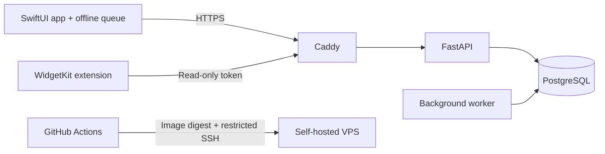

# Can / Можно

[Русский](README.ru.md) · [Backend CI](https://github.com/can-budget/budget/actions/workflows/verify.yml) · [iOS CI](https://github.com/can-budget/budget/actions/workflows/ios.yml) · [MIT](LICENSE)


A native iPhone app for a shared daily budget. Set an amount and an end date, record expenses, and see what is left to spend today. Built with SwiftUI and WidgetKit, backed by a self-hosted FastAPI service.

## What it does

- One shared budget for up to 10 equal members, with invitations and an operation history.
- A calculator with a live local preview; Enter submits the operation.
- Topups go entirely to today. Daily overspending uses the remaining bank; the bank cannot go below zero.
- A forecast for the remaining days and a shared decision about unspent money.
- Saving a new amount and date starts a fresh budget and preserves the previous one in history.
- A durable offline queue with idempotent commands and explicit handling of conflicts and unknown outcomes.
- Home Screen and Lock Screen widgets with a limited, read-only credential.

The app interface is currently Russian. This repository includes English and Russian project documentation. There is no public signup or hosted demo: deploy your own API and provision accounts privately.

## Build and check

Python 3.11+:

```sh
make install
make verify
```

`verify` runs API unit tests, infrastructure tests, calculation fixtures, contract checks, lint, type checking and iOS project validation. It does not deploy, run migrations or connect to a database. PostgreSQL integration tests run separately against a disposable database in CI.

On macOS with Xcode 26+ and an installed iOS Simulator runtime:

```sh
make ios-build
make ios-test
make ios-sideload
```

Configure your API origin before building for a phone. The sideload command produces an IPA containing the app and widget; SideStore performs the Apple signing. Free signatures expire after seven days and require renewal. A generated Shortcut can renew SideStore and Can, then disconnect LocalDevVPN. See [iPhone installation](docs/IOS_DELIVERY.md) and [renewal automation](docs/IOS_AUTO_REFRESH.md).

## Architecture



Amounts use integer minor units. The server authorizes membership and serializes budget mutations in PostgreSQL transactions. The app shares calculation fixtures with the backend. Business dates currently use `Asia/Shanghai`.

| Directory | Contents |
| --- | --- |
| [`apps/ios`](apps/ios) | SwiftUI app, widgets, local state, Xcode tests and build helpers |
| [`services/api`](services/api) | Authentication, ledger, migrations and background worker |
| [`contracts`](contracts) | Current API contract and calculation-policy notes |
| [`reference`](reference) | Historical calculation engines and regression fixtures |
| [`infra`](infra) | Docker Compose, HTTPS and deployment receiver |

## Deployment and security

Backend pushes to `main` run checks, publish a GHCR image and deploy its immutable digest through a restricted SSH receiver. iOS has a separate unsigned build/test workflow; backend deployment does not install an iPhone update.

See [operations](infra/README.md), [CI/CD](infra/CI_CD.md), [architecture](docs/ARCHITECTURE.md) and [security policy](SECURITY.md). The current personal deployment uses one VPS with persistent local data and no off-site backup; this is an availability tradeoff, not a recovery guarantee.

Physical installation and manual renewal have been verified on the first iPhone. A second-phone setup and unattended renewal with a locked screen are separate device checks. Widget refresh timing is controlled by iOS; instant cross-device widget updates are not guaranteed.

Contributions: [CONTRIBUTING.md](CONTRIBUTING.md). License: [MIT](LICENSE), © 2026 Egor Logutov.
