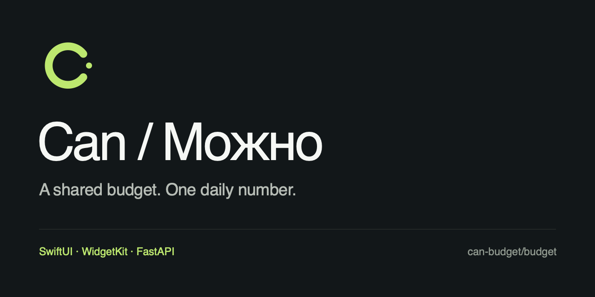

# Can / Можно

[English](README.md) · [Backend CI](https://github.com/can-budget/budget/actions/workflows/verify.yml) · [iOS CI](https://github.com/can-budget/budget/actions/workflows/ios.yml) · [MIT](LICENSE)



Нативное приложение для iPhone с общим дневным бюджетом. Задайте сумму и дату окончания, записывайте расходы и смотрите, сколько осталось на сегодня. SwiftUI и WidgetKit на телефоне, собственный сервер на FastAPI.

## Возможности

- Один общий бюджет для группы до 10 равноправных участников, приглашения и история операций.
- Калькулятор сразу показывает результат ввода; операция отправляется после Enter.
- Пополнение целиком добавляется на сегодня. Дневной перерасход берётся из общего банка, который нельзя потратить ниже нуля.
- Прогноз на оставшиеся дни и общий выбор, что делать с неизрасходованной суммой.
- Новая сумма и дата запускают новый бюджет; предыдущий остаётся в истории.
- Сохранённая на устройстве очередь офлайн-операций, защита от повторного применения и явная обработка конфликтов.
- Виджеты домашнего экрана и экрана блокировки с отдельным доступом только на чтение.

Интерфейс приложения — на русском. Документация проекта доступна на русском и английском. Публичной регистрации и общего демо-сервера нет: поднимите свой API и создайте учётные записи через закрытую административную команду.

## Сборка и проверки

Python 3.11+:

```sh
make install
make verify
```

`verify` запускает unit-тесты API, инфраструктурные тесты, эталонные расчёты, проверки контрактов, линтер, проверку типов и структуры iOS-проекта. Команда не запускает деплой, миграции или подключение к БД. Интеграционные тесты PostgreSQL выполняются отдельно в изолированной БД CI.

На Mac с Xcode 26+ и установленным iOS Simulator:

```sh
make ios-build
make ios-test
make ios-sideload
```

Перед сборкой на телефон укажите адрес своего API. Команда sideload создаёт IPA с приложением и виджетом; подпись выполняет SideStore. Бесплатная подпись действует семь дней и требует продления. Генератор «Команды» создаёт продление SideStore и Can с отключением LocalDevVPN после успеха. Подробнее: [установка на iPhone](docs/IOS_DELIVERY.md), [автопродление](docs/IOS_AUTO_REFRESH.md).

## Устройство проекта

Деньги хранятся целыми числами в минимальных денежных единицах. Сервер проверяет членство и последовательно выполняет изменения бюджета в транзакциях PostgreSQL. Приложение и backend проверяются на общих расчётных сценариях. Бизнес-дата сейчас фиксирована в `Asia/Shanghai`.

| Каталог | Содержимое |
| --- | --- |
| [`apps/ios`](apps/ios) | Приложение, виджеты, локальная очередь, Xcode-тесты и сборка |
| [`services/api`](services/api) | Авторизация, журнал операций, миграции и worker |
| [`contracts`](contracts) | Действующий API-контракт и правила расчёта |
| [`reference`](reference) | Эталонные движки и регрессионные сценарии |
| [`infra`](infra) | Docker Compose, HTTPS и приёмник обновлений |

Схема обмена данными: [архитектура](docs/ARCHITECTURE.md).

## Деплой и безопасность

Изменения в `main` проходят проверки, собираются в GHCR и доставляются на VPS по неизменяемому digest через ограниченный SSH-приёмник. iOS собирается и тестируется отдельным workflow; деплой backend не устанавливает обновление на телефон.

Инструкции: [сервер](infra/README.md), [CI/CD](infra/CI_CD.md), [безопасность](SECURITY.md). Текущий личный сервер — один VPS с постоянным локальным диском без внешних бекапов. При потере сервера данные не восстановятся автоматически.

На первом iPhone проверены установка и ручное продление. Установка на второй телефон и запуск продления по расписанию с заблокированным экраном проверяются отдельно. Частотой обновления виджетов управляет iOS; мгновенное обновление после покупки другого участника не гарантируется.

Участие в разработке: [CONTRIBUTING.md](CONTRIBUTING.md). Лицензия: [MIT](LICENSE), © 2026 Egor Logutov.
