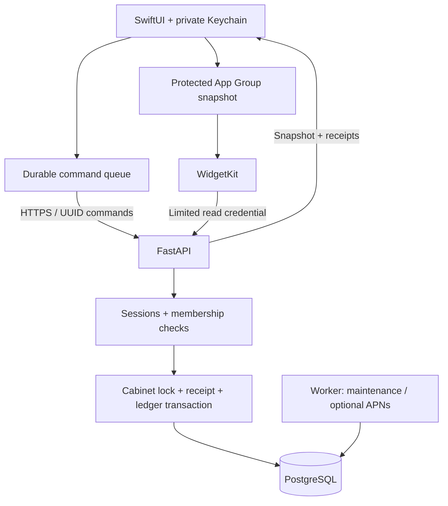

# Architecture

Can has a native iOS client, a WidgetKit extension and a self-hosted API. The API is authoritative for accepted operations; the client keeps durable local intentions and computes a provisional projection while offline.

## Budget calculations

Amounts are integer minor units; business dates use `Asia/Shanghai`. A budget records its initial amount, start and end dates, calculation version, expenses, topups and carry decisions. Version 3 assigns an entire topup to its effective day; historical version-2 calculations remain supported. Unchanged v2 regression cases and shared v3 cases check Python/Swift parity.

Spending may exceed today's allowance but cannot make the total bank negative. The server checks this under a cabinet lock, including corrections and cancelled topups. Saving a new amount/date completes the previous budget and creates a new one atomically. Existing history is preserved.

## Synchronization

The client persists a command UUID before sending. A sent command is immutable. The server stores applied/rejected receipts and rejects reuse with a different payload. Sync returns a snapshot and outcomes for unresolved command IDs; the client removes only confirmed operations and does not overlay an acknowledged operation twice. Unknown outcomes remain recoverable instead of being silently dropped.

Membership epochs prevent an old offline entry from crossing a leave/rejoin boundary. Revisions and business dates prevent stale edits from silently replacing a newer state. Account deletion removes identifying links while retaining shared numeric history.

## Authentication and widgets

Private operator-provisioned logins exchange a password for short-lived bearer credentials and a rotating refresh credential. The application stores credentials in its private Keychain group. A separate widget token permits only a small read projection and is revoked on logout or loss of access. App Group files let widgets show the local projection, including pending changes. iOS determines timeline refresh timing.

Apple sign-in and APNs are optional integrations. The free SideStore distribution uses password login and does not require these provider keys.

## Delivery

Caddy terminates public HTTPS and forwards to an internal API container. PostgreSQL is on an internal Docker network. GitHub Actions verifies Python/static checks and disposable PostgreSQL integration, publishes a backend image and sends its digest and reviewed infra to a restricted SSH receiver. Deployment is serialized and checks source/image identity and health. A single-server update may briefly interrupt API availability.

The iOS workflow builds/tests without owner signing and is independent of backend deployment. Local release helpers build a SideStore IPA; installing or updating that IPA on a phone is a separate step. A device-specific Shortcut handles signature renewal, not application code updates.
